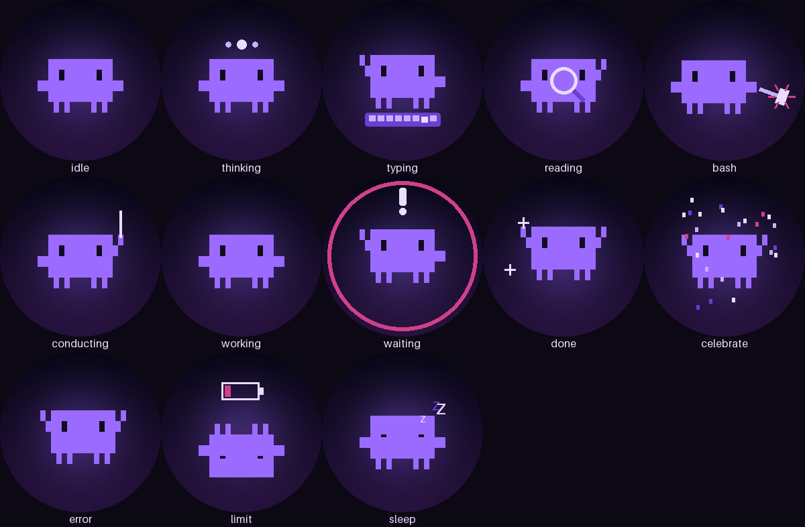

# kraken-clawd

Die Claude-Code-Figur („Clawd“) in Lila, animiert auf dem runden LCD einer **NZXT Kraken 2023** unter Linux. Ein kleiner Daemon empfängt [Claude-Code-Hooks](https://code.claude.com/docs/en/hooks) und zeigt live, was deine Sessions gerade tun: tippen, lesen, Bash, Subagents dirigieren, auf dich warten, fertig, Fehler, Rate-Limit, schlafen.

> **Inoffizielles Fan-Projekt.** Nicht mit Anthropic verbunden oder von Anthropic unterstützt. „Claude“ und die Claude-Code-Figur sind Marken bzw. Designs von Anthropic; die Figur ist hier als Pixel-Raster nachgebaut.



## Wie es funktioniert

```
Claude Code (alle Sessions) ──HTTP-Hooks──▶ 127.0.0.1:7377/hook
                                              │
                         state.py  Sessions → ein Anzeige-Modell (Prioritäten: limit > waiting > error > arbeitet > done > idle)
                         render.py Figur + Mini-Clawds (weitere Sessions) + Subagent-Klone
                         lcd.py    240×240 RGB565 per liquidctl, ~15 fps
```

Die Kraken-2023-Firmware 2.x kann keine GIFs abspielen. Der Daemon streamt deshalb Einzelbilder über eine interne liquidctl-Methode (`_send_2023_data_fw2`, ~37 fps möglich). Fällt diese Methode weg, nutzt er das öffentliche `set_screen` mit ~8 fps.

## Voraussetzungen

- Linux, NZXT Kraken 2023 (USB `1e71:300e`), Zugriff ohne root per udev-Regel (siehe [liquidctl-Doku](https://github.com/liquidctl/liquidctl))
- Python 3.13 mit [uv](https://docs.astral.sh/uv/), Node (für den Hook-Installer), Claude Code

## Installation

```bash
git clone https://github.com/Felix-Hempel/kraken-clawd.git ~/Documents/IT/kraken-clawd
cd ~/Documents/IT/kraken-clawd && uv sync
node install-hooks.mjs                       # trägt die HTTP-Hooks in ~/.claude/settings.json ein (Backup wird angelegt)
ln -sf "$PWD/systemd/kraken-clawd.service" ~/.config/systemd/user/
systemctl --user daemon-reload && systemctl --user enable --now kraken-clawd
```

Die Unit erwartet das Repo unter `~/Documents/IT/kraken-clawd` und ruft beim Stoppen `~/.config/rgb-aurora/kraken.sh` auf, um ein statisches Bild zurückzusetzen. Beides bei Bedarf in `systemd/kraken-clawd.service` anpassen.

## Bedienung

- Daemon: `systemctl --user {status,restart,stop} kraken-clawd`
- Hooks entfernen: `node install-hooks.mjs --remove`. Das ist nötig, bevor du den Dienst dauerhaft stoppst oder deinstallierst. Sonst zeigt Claude Code bei jedem Hook einen nicht blockierenden „hook error“.
- Vorschau ohne LCD: `uv run python -m kraken_clawd.preview` (schreibt `preview/*.gif`)
- Eine Animation am LCD testen: `uv run python -m kraken_clawd.try_lcd <name> <sekunden>` (Daemon vorher stoppen)
- Alle Zustände durchspielen: `./demo.sh`
- Tests: `uv run pytest`

## Hinweise

- `liquidctl` ist auf 1.16.0 gepinnt, weil eine private Methode genutzt wird. Nach einem Update den Fast-Path prüfen (Log: `Kraken verbunden (Fast-Path: True)`).
- Mein Setup: `rgb-aurora.service` schreibt beim Start ein Eclipse-Bild; der Daemon startet danach (`After=rgb-aurora.service`) und überschreibt es im nächsten Frame.
- Design und Umsetzungsplan: `docs/superpowers/`.

## Lizenz

MIT für den Code. Die Rechte an der Figur liegen bei Anthropic (siehe Hinweis oben).
